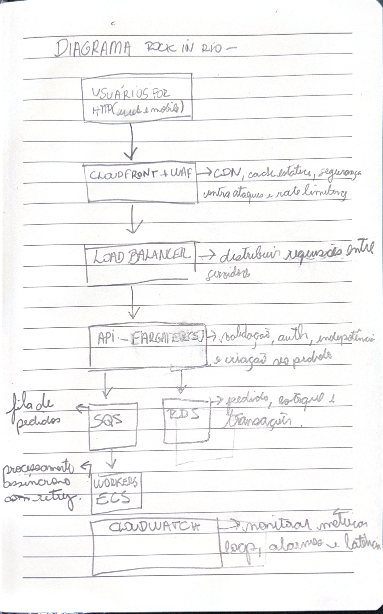

# System Design — Rock in Rio

## Sobre o projeto

Proposta de arquitetura para um sistema de venda de ingressos para um evento de grande porte, como o Rock in Rio.

O objetivo é suportar picos de acessos simultâneos, manter a disponibilidade da aplicação e evitar a venda duplicada de ingressos.

## Diagrama da arquitetura

[Visualizar PDF original](./DIAGRAMA%20ROCK%20IN%20RIO%20-.pdf)

## Fluxo da arquitetura

1. **Usuários:** acessam a plataforma via web ou dispositivos móveis.
2. **CloudFront + AWS WAF:** distribuem conteúdo em cache, filtram requisições maliciosas e ajudam a controlar tráfego abusivo.
3. **Load Balancer:** distribui as requisições entre as instâncias saudáveis da aplicação.
4. **API — ECS/Fargate:** realiza autenticação, validações e criação dos pedidos.
5. **SQS:** recebe mensagens para desacoplar a criação dos pedidos do processamento em segundo plano.
6. **Redis:** mantém dados temporários em cache, reduzindo consultas repetidas ao banco de dados.
7. **Workers — ECS:** consomem mensagens da fila e processam os pedidos de forma assíncrona.
8. **Banco de dados:** persiste pedidos, estoque e transações, garantindo a consistência das operações.
9. **CloudWatch:** monitora métricas, logs, alarmes e latência para identificar falhas e gargalos.

## Tecnologias AWS

| Serviço | Responsabilidade |
|---|---|
| Amazon CloudFront | Distribuição de conteúdo e cache |
| AWS WAF | Proteção contra tráfego malicioso |
| Application Load Balancer | Distribuição de requisições |
| Amazon ECS / AWS Fargate | Execução e escalabilidade da aplicação |
| Amazon SQS | Fila de processamento assíncrono |
| Redis | Cache e armazenamento temporário |
| Banco de dados | Persistência de pedidos, estoque e transações |
| Amazon CloudWatch | Monitoramento e observabilidade |

## Decisões de arquitetura

- **Escalabilidade horizontal:** aumentar a capacidade de processamento conforme a demanda.
- **Desacoplamento:** utilizar SQS para separar a recepção dos pedidos do processamento assíncrono.
- **Consistência de estoque:** controlar reservas e vendas no banco de dados para evitar vender mais ingressos do que o disponível.
- **Idempotência:** evitar a criação ou o processamento duplicado de pedidos em caso de retentativas.
- **Observabilidade:** monitorar a saúde dos serviços e identificar gargalos durante os picos de acesso.

## Possíveis evoluções

- Implementar uma fila virtual para controlar a entrada de usuários durante picos extremos.
- Adicionar retentativas e Dead-Letter Queues (DLQ) para mensagens que falharem repetidamente.
- Implementar o padrão Transactional Outbox para aumentar a confiabilidade na publicação de eventos.
- Realizar testes de carga para validar a capacidade e definir políticas de escalabilidade.
- Automatizar a infraestrutura com Terraform e pipelines de CI/CD.

## Objetivo

Demonstrar a aplicação de conceitos de System Design, Cloud Computing e Sistemas Distribuídos na construção de uma plataforma de venda de ingressos escalável, resiliente e confiável.
